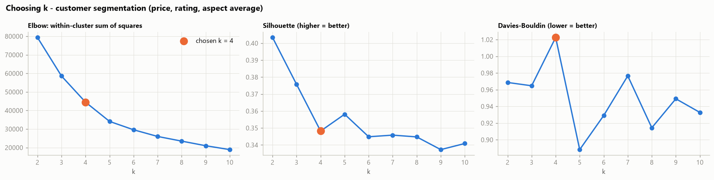
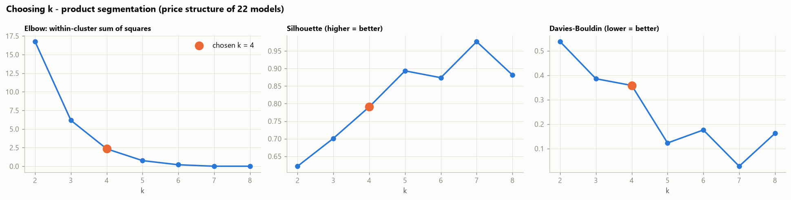
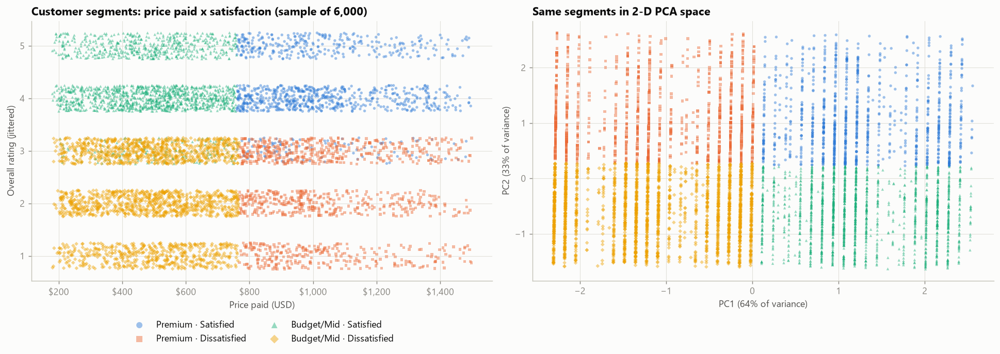
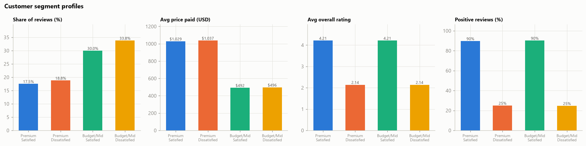
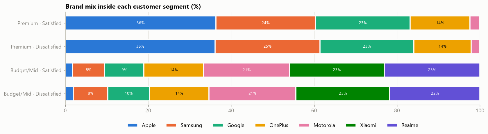
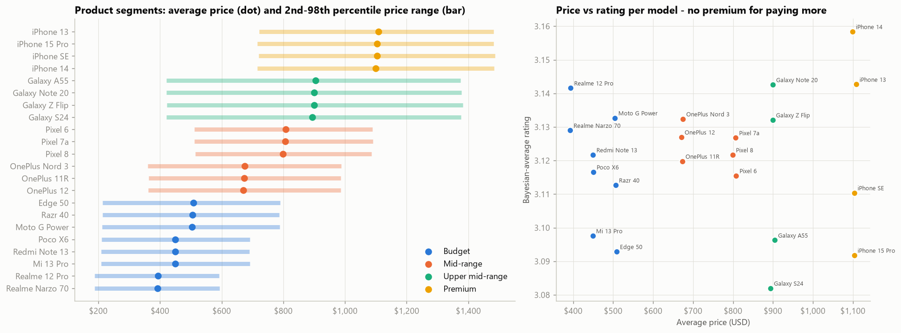

# Cluster Analysis Report: K-Means Segmentation

**Code:** `src/segmentation.py` · **Saved models:** `models/kmeans_customer_segments.joblib` and `models/kmeans_product_segments.joblib` (each is a StandardScaler + KMeans pipeline) · **Tables:** `reports/*_segment_profile.csv` and `reports/*_k_selection.csv`

Segmentation is done at two levels, as the spec asks ("products or users"):

| Level | Rows | Features (standardised) | k | Silhouette |
|---|---|---|---|---|
| **Customer / review** | 50,000 purchases | `price_usd`, `rating`, `aspect_avg` | 4 | 0.348 (10k sample) |
| **Product** | 22 phone models | average price, 2nd-percentile price, 98th-percentile price | 4 | 0.791 |

---

## 1. Feature selection, encoding and scaling

* **Scaling:** every K-Means input passes through `StandardScaler`, inside the saved pipeline. Price in dollars and ratings in stars then carry equal weight, and the app applies the same scaling to new inputs.
* **Why these customer features:** the EDA showed that buyers differ in only two ways, **how much they paid** and **how satisfied they are**. Brand, country, age group, source and verified status have no relationship with satisfaction (all χ² / ANOVA p > 0.3).
* **Encoding check:** brand and country were also one-hot encoded and added (together with age and engagement score) to a second K-Means run. **Silhouette fell from 0.348 to 0.135** and Davies-Bouldin rose from 1.02 to 2.17. The dummies split the data along categories with no behavioural signal. The encoded columns are kept in `feature_engineered_mobile_reviews.csv` (label codes + one-hot), but the final clustering uses the behavioural features.
* **Why product clustering uses price only:** across the 22 models the coefficient of variation is **34%** for average price and **0.8%** for rating (2.0% for positive share, 0.8% for aspect average). An earlier trial that included rating features split the four iPhones into different clusters because of rating noise of about 0.03★. Price structure gives clean, explainable tiers.

## 2. Choosing the number of clusters



| k | Silhouette | Davies-Bouldin | Cluster profile |
|---|---|---|---|
| 2 | 0.404 | 0.97 | Splits on satisfaction only. Both clusters average about $690, so **price is ignored**. |
| 3 | 0.376 | 0.96 | Mixed groups that are hard to name |
| **4** | **0.348** | 1.02 | **Premium / Budget-Mid × Satisfied / Dissatisfied: clean 2 × 2** |
| 5 | 0.358 | 0.89 | Same as k = 4 plus a "neutral 3★" budget group |
| 6–10 | 0.34–0.35 | 0.91–0.98 | Further splits along rating levels |

The elbow bends at k = 4. Silhouette is flat at about 0.35 from k = 4 to k = 10, so a larger k gives no better separation. **k = 4 is the smallest k that captures both dimensions**, and it matches the spec's suggested 4 segments.



For products, silhouette keeps rising with k only because each brand sells all its models in one shared price band. k = 7 is simply one cluster per brand (silhouette 0.98) and tells us nothing new. **k = 4 gives the market tiers Budget, Mid-range, Upper mid-range and Premium**, with silhouette 0.79 and Davies-Bouldin 0.36.

## 3. Customer segments




| Segment | Share | Avg price | Avg rating | Positive | Negative | Helpful votes | Top brand |
|---|---|---|---|---|---|---|---|
| **Premium · Satisfied** | 17.5% | $1,029 | 4.21 | 89.7% | 0.9% | 4.69 | Apple |
| **Premium · Dissatisfied** | 18.8% | $1,037 | 2.14 | 25.0% | 36.3% | 2.71 | Apple |
| **Budget/Mid · Satisfied** | 30.0% | $492 | 4.21 | 90.2% | 1.0% | 4.69 | Realme |
| **Budget/Mid · Dissatisfied** | 33.8% | $496 | 2.14 | 24.6% | 35.9% | 2.69 | Xiaomi |

The cluster centroids (price, rating, aspect avg) are $1,029 / 4.21 / 3.71, $1,038 / 2.14 / 1.82, $492 / 4.21 / 3.71 and $497 / 2.14 / 1.83. The price boundary falls at about $760.

**Interpretation and actions:**

* **Premium · Satisfied (advocates):** they paid more than $1,000 and love their phone. Use them for referral programmes, ecosystem and accessory upsell, and early access to new models.
* **Premium · Dissatisfied (at risk):** an expensive phone with a poor experience, rated about 2.1★ on every aspect. This is the highest-value group to recover. Offer proactive support, extended warranty and trade-in or upgrade offers. Apple, as the premium brand, carries most of them.
* **Budget/Mid · Satisfied (value seekers):** happy buyers at about $490. Target them with value bundles and a trade-up path to mid-range.
* **Budget/Mid · Dissatisfied (largest group, 34%):** quality fixes and clearer expectation-setting at the low end reach the most customers.



Within each price tier, satisfied and dissatisfied buyers have **the same brand mix, age (about 30), verified share (about 80%) and country mix**. Dissatisfaction is spread evenly and not tied to a brand. Dissatisfied reviews get about 42% fewer helpful votes.

## 4. Product segments



| Segment | Models | Brands | Reviews | Avg price | Price range | Avg rating | Positive | Value (★ / $100) |
|---|---|---|---|---|---|---|---|---|
| **Budget** | 8 | Motorola, Realme, Xiaomi | 21,434 (43%) | $457 | $188 – 790 | 3.117 | 55.5% | 0.78 |
| **Mid-range** | 6 | Google, OnePlus | 14,370 (29%) | $739 | $361 – 1,090 | 3.124 | 56.0% | 0.46 |
| **Upper mid-range** | 4 | Samsung | 7,052 (14%) | $899 | $420 – 1,382 | 3.111 | 55.4% | 0.39 |
| **Premium** | 4 | Apple | 7,144 (14%) | $1,104 | $715 – 1,486 | 3.127 | 56.0% | 0.30 |

* Budget is the **volume segment**, with 43% of reviews, and offers the best value: 2.6× the rating per dollar of Premium.
* Ratings and positive share are statistically the same across all four tiers. **The premium price is not backed by a higher review score.** Premium brands should justify their price through brand, ecosystem and service, not through spec ratings.

## 5. Using the models

```python
km = joblib.load("models/kmeans_customer_segments.joblib")
km.predict(pd.DataFrame([{"price_usd": 1150, "rating": 2, "aspect_avg": 1.8}]))  # -> Premium · Dissatisfied
```

The Streamlit **Segmentation → Which segment am I?** page uses this pipeline. It warns when the price is outside the training range ($180 – $1,500).

## 6. Limitations

* The data looks synthetic: ratings are independent of price, brand and country. Because of that, the customer segments separate on price and satisfaction rather than on richer behaviour.
* A silhouette of about 0.35 means the customer segments are distinct but not far apart. Ratings are discrete (1–5), so neighbouring rating levels touch.
