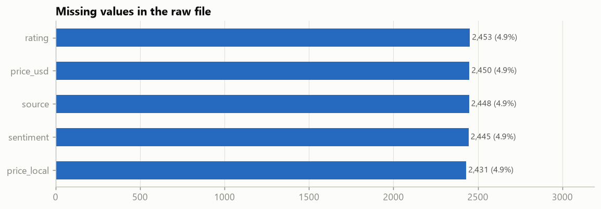
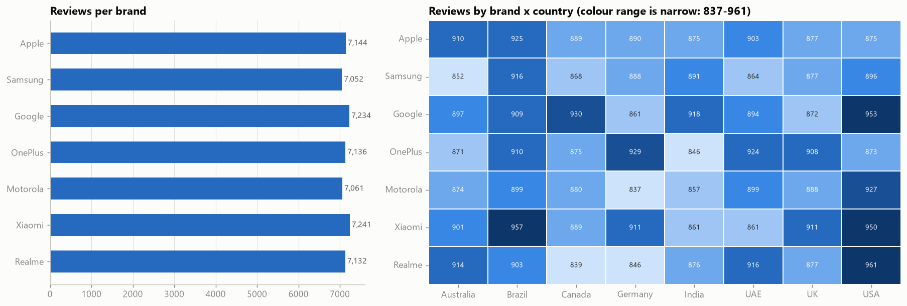
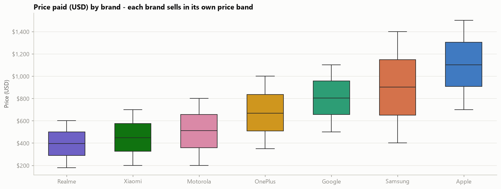
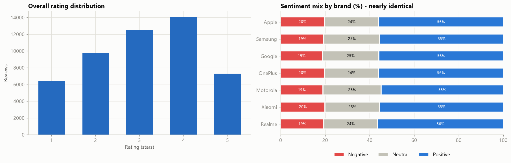
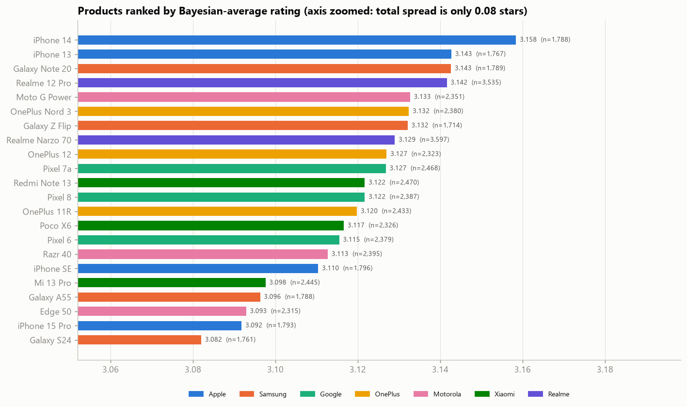
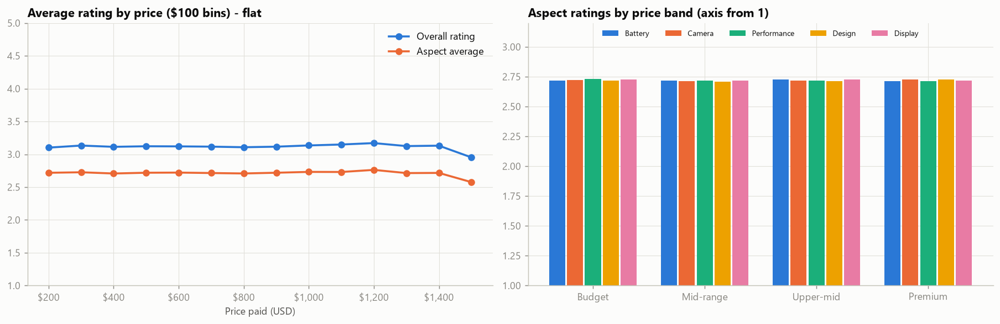
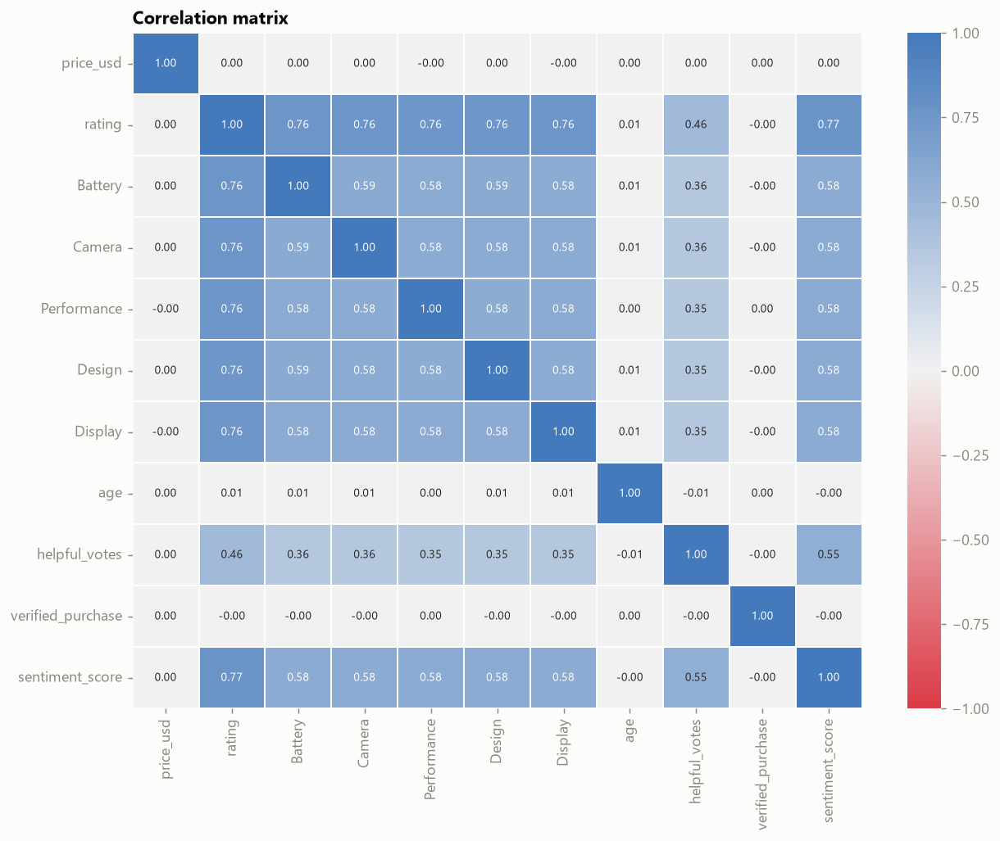
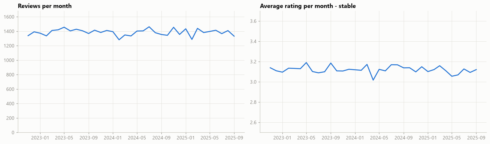
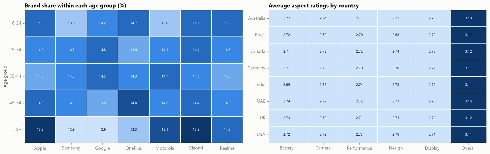
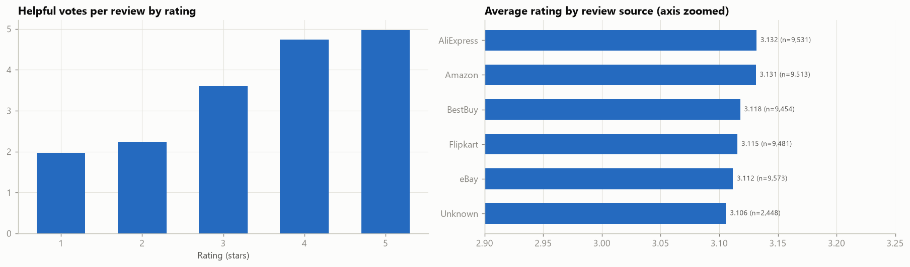

# EDA Report: Global Mobile Reviews

**Dataset:** `Mobile Reviews Sentiment null.csv`. 50,000 reviews × 22 columns, covering 7 brands, 22 phone models and 8 countries, with reviews dated Oct 2022 to Oct 2025.
**Generated by:** `src/eda.py` (figures go to `reports/figures/eda_*.png` and tables to `reports/eda_tables/*.csv`)

---

## 1. Data quality and cleaning

| Issue | Rows | Treatment |
|---|---|---|
| `price_usd` missing | 2,450 (4.9%) | **Recovered exactly** for 2,327 rows using `price_usd = price_local / exchange_rate`. The identity holds on 100% of complete rows, with a max error of $0.005. |
| `price_local` missing | 2,431 (4.9%) | **Recovered exactly** for 2,308 rows using `price_usd × exchange_rate` |
| Both prices missing | 123 | Filled with the model's median price. Each model has its own price band. |
| `rating` missing | 2,453 (4.9%) | Filled with the most frequent rating among reviews that share the same aspect-rating average and sentiment. On held-out rows this rule is **77.8% exact and 99.97% within ±1 star**; filling with the overall mode scores 28.1%. |
| `sentiment` missing | 2,445 (4.9%) | Filled with the most frequent sentiment for the same rating and aspect average. Held-out accuracy is **74.5%**; the overall mode scores 56.1%. |
| `source` missing | 2,448 (4.9%) | Set to `Unknown`. The source column has no relationship with any other column. |
| Duplicates | 0 | Three checks were run: exact rows, repeated `review_id`, and the same content under a new id |
| Type conversion | all | `review_date` → datetime. `price_local` text (`₹27996.73`, `$1,010.68 `) → numeric `price_local_value`. Flags → bool. Counts → int. |
| Validation | 0 conflicts | brand↔model, country↔currency↔rate, rating 1–5, age 18–65 |

Result: 50,000 clean rows with no remaining nulls (`data/processed/cleaned_mobile_reviews.csv`). Every imputed value is flagged in `price_imputed`, `rating_imputed` or `sentiment_imputed`.

## 2. Product distribution across brands and countries

* Each brand has about 7,100 reviews (7,052–7,241), and each country has about 6,200.
* The brand × country counts range only from 837 to 961. A χ² test of brand vs country gives p = 0.83: **brand mix is the same in every market.**
* Realme has only 2 models, so each Realme model has the most reviews (Narzo 70: 3,597; 12 Pro: 3,535). Each Apple and Samsung model has about 1,750.

## 3. Price structure

| Brand | Avg price | Range (USD) | Value score (★ per $100) |
|---|---|---|---|
| Apple | $1,104 | 700 – 1,500 | 0.30 |
| Samsung | $899 | 400 – 1,400 | 0.39 |
| Google | $805 | 500 – 1,100 | 0.41 |
| OnePlus | $673 | 350 – 1,000 | 0.51 |
| Motorola | $506 | 200 – 800 | 0.71 |
| Xiaomi | $450 | 200 – 700 | 0.78 |
| Realme | $393 | 180 – 600 | 0.89 |

Price is the dimension that separates brands most strongly (ANOVA F = 12,801, p ≈ 0). Every model of a brand sells inside that brand's band.

## 4. Ratings and sentiment

* The mean rating is 3.12★. The most common rating is 4★ (14k reviews).
* Sentiment splits about 56% positive, 25% neutral and 19–20% negative **for every brand** (χ² sentiment vs brand: p = 0.33).
* Rating and sentiment agree closely but not perfectly: 25 one-star reviews are marked Positive. That is noise in the source data and was kept as-is.

## 5. Top-rated and low-rated products

Products are ranked by Bayesian-average rating, shrunk toward the global mean with m = 500 so that models with more reviews are compared fairly.

| Top 5 | Rating | Bottom 5 | Rating |
|---|---|---|---|
| iPhone 14 | 3.158 | Galaxy S24 | 3.082 |
| iPhone 13 | 3.143 | iPhone 15 Pro | 3.092 |
| Galaxy Note 20 | 3.143 | Edge 50 | 3.093 |
| Realme 12 Pro | 3.142 | Galaxy A55 | 3.096 |
| Moto G Power | 3.133 | Mi 13 Pro | 3.098 |

**Important:** the gap between the best and worst model is only **0.08★**. A one-way ANOVA across the 22 models gives **p = 0.78**, and across brands **p = 0.81** (Kruskal-Wallis p = 0.71). The differences are not statistically significant, so no product is a genuine outlier.

## 6. Price, ratings and specifications

* **Price vs rating: r = 0.001 (p = 0.74).** Price vs aspect average: Spearman ρ = 0.001. Paying more does not raise satisfaction or any aspect score.
* Each aspect (battery, camera, performance, design, display) correlates **0.76** with the overall rating. All five weigh **equally**.
* Each pair of aspects correlates about 0.58: a buyer who is unhappy with one aspect tends to be unhappy with all of them.
* Helpful votes correlate with rating (r = 0.46, p ≈ 0). Positive reviews get more helpful votes.
* Age, verified purchase and price have no correlation with any rating.

## 7. Patterns and trends over time

There are about 1,400 reviews per month. The monthly average rating is flat at about 3.1★ for the whole 3-year window, with no seasonality or drift.

## 8. Customer preference patterns

* Each brand holds about 14% share in every age group (χ² p = 0.52) and every country (p = 0.83).
* Aspect ratings by country all fall in the range 2.68–2.76.
* Sentiment does not depend on country (p = 0.37) or source (p = 0.72). Verified and unverified buyers rate the same (Welch t-test p = 0.87).
* **So customers differ in how much they pay and how satisfied they are, not in which brand, country or channel they come from.** This is why the customer segmentation in `Cluster_Analysis_Report.md` uses price and satisfaction.

## 9. Statistical summary (α = 0.05)

| Test | Statistic | p-value | Significant? |
|---|---|---|---|
| ANOVA: rating by brand | F = 0.50 | 0.807 | no |
| ANOVA: rating by model | F = 0.75 | 0.778 | no |
| ANOVA: price by brand | F = 12,801 | < 0.001 | **yes** |
| χ²: sentiment vs brand | 13.5 | 0.332 | no |
| χ²: sentiment vs country | 15.2 | 0.366 | no |
| χ²: sentiment vs source | 7.0 | 0.722 | no |
| χ²: brand vs age group | 22.9 | 0.523 | no |
| χ²: brand vs country | 33.2 | 0.832 | no |
| Pearson: price vs rating | r = 0.001 | 0.738 | no |
| Pearson: helpful votes vs rating | r = 0.460 | < 0.001 | **yes** |
| Welch t: verified vs not | t = −0.17 | 0.869 | no |

Full numbers are in `reports/eda_tables/statistical_tests.json`.

## 10. Key findings

1. **Price is the main structure in this market.** Brands occupy clear price tiers: Budget (Realme, Xiaomi, Motorola), Mid-range (OnePlus, Google), Upper mid-range (Samsung) and Premium (Apple).
2. **Satisfaction does not rise with price.** Budget phones deliver about 2.6× more rating per dollar.
3. **Product differences in quality are too small to be significant.** Rankings exist, but they fall within statistical noise.
4. **Satisfaction is polarised within every price tier.** About half the buyers are happy (about 4.2★) and half are unhappy (about 2.1★). This split drives the customer segments.
5. **Preferences are global.** Brand choice and satisfaction do not vary by country, age, source or verification status.
