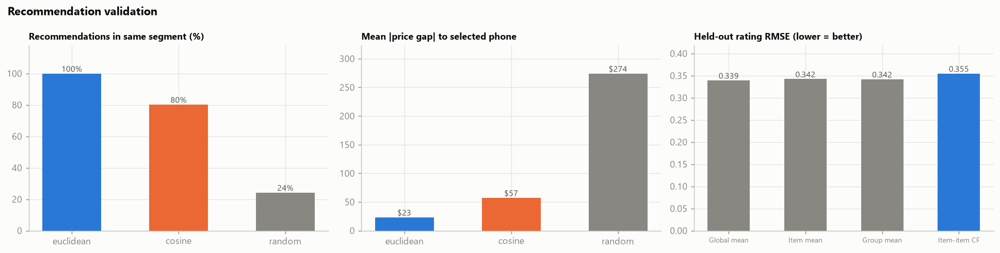
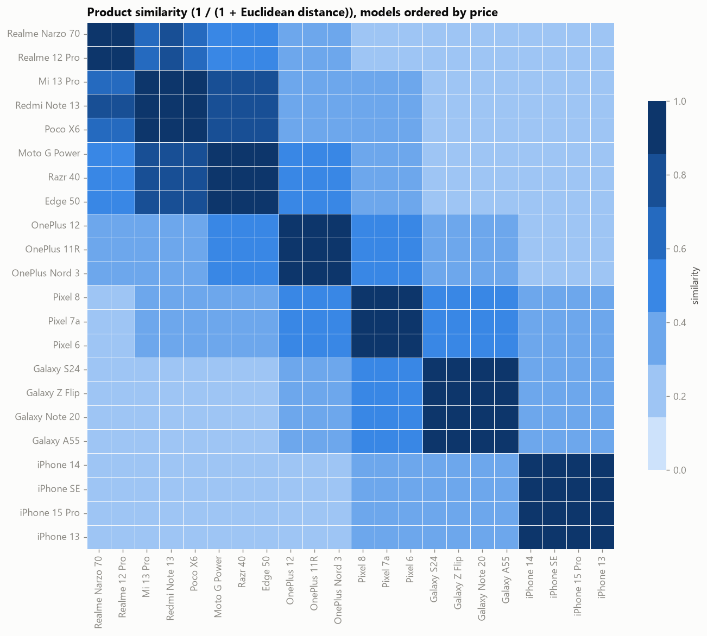

# Recommendation System Report

**Code:** `src/recommender.py` (class `ProductRecommender`) · **Saved artifacts:** `models/similarity_euclidean.csv`, `similarity_cosine.csv` and `similarity_item_cf.csv` · **App:** the Streamlit **Recommend** page

The system is built only from structured data. It has three parts.

## 1. Content-based "similar phones" (selected product → similar products)

Each of the 22 models is a feature vector with these parts:

| Feature group | Columns | Scaling |
|---|---|---|
| Price structure | average price, 2nd- and 98th-percentile price | z-score across models |
| Quality | average rating, positive share, five average aspect ratings | centred, then divided by the **review-level** standard deviation |

The quality features are scaled by how much single reviews vary (about 1.3★). A 0.05★ difference between two models therefore counts as the small difference it really is. Plain z-scoring would inflate that noise to the same weight as a $600 price gap.

Two similarity measures were implemented and compared:

* **Cosine similarity**: `cosine_similarity(vectors)`
* **Distance-based**: `1 / (1 + Euclidean distance)`

### Validation: top-3 recommendations for every model

| Metric | Same product segment | Mean price gap | Mean rating gap | Other-brand share | Catalog coverage |
|---|---|---|---|---|---|
| **Euclidean (default)** | **100%** | **$23** | 0.028 | 24% | 100% |
| Cosine | 80% | $57 | 0.029 | 32% | 95% |
| Random baseline | 24% | $274 | 0.026 | 89% | 86% |



Euclidean similarity keeps every recommendation in the selected phone's segment, and its price gap is 12× smaller than random. Cosine similarity measures only the *direction* of a vector, not its distance. On mostly price-driven vectors it treats "a bit cheaper than average" and "much cheaper than average" as nearly identical. For example, it recommends OnePlus 11R for Realme 12 Pro with similarity 0.997. **Euclidean is therefore the default**; the app still lets users switch to cosine.



Example output (`reports/recommendation_examples.csv`):

| Selected | Top 3 recommendations (similarity) |
|---|---|
| iPhone 14 | iPhone 13 (0.93), iPhone SE (0.89), iPhone 15 Pro (0.86) |
| Galaxy S24 | Galaxy A55 (0.94), Galaxy Z Flip (0.88), Galaxy Note 20 (0.88) |
| Pixel 8 | Pixel 7a (0.95), Pixel 6 (0.95), OnePlus 11R (0.50) |
| OnePlus 12 | OnePlus 11R (0.96), OnePlus Nord 3 (0.95), Pixel 8 (0.50) |
| Realme 12 Pro | Realme Narzo 70 (0.96), Redmi Note 13 (0.72), Poco X6 (0.71) |

The app has an **"Other brands only"** toggle. It gives cross-brand alternatives, such as Pixel 8 → OnePlus models.

## 2. Preference-based recommendations (user input → products)

The user enters a country (the budget is shown in that country's currency), an age group, a budget range, a 0–5 importance weight for each aspect, and optional brands. Each phone that sells within the budget gets a score:

```
score = 0.50 × priority-aspect rating from buyers in the same country & age group (/5)
      + 0.10 × collaborative-filtering predicted rating for that customer group (/5)
      + 0.20 × positive-review share
      + 0.20 × share of the phone's observed prices that fall inside the budget
```

If fewer than 30 peer reviews exist, the aspect score falls back to all buyers.

### Validation on example profiles

| Profile | Budget (USD) | Priorities | Top 3 | In budget | Priority score of recs vs catalog |
|---|---|---|---|---|---|
| Student on a budget (India, 18-24) | 150-450 | Battery, Performance | Realme 12 Pro, Realme Narzo 70, Redmi Note 13 | 100% | 2.75 vs 2.72 |
| Camera-first creator (USA, 25-34) | 600-1100 | Camera, Display | Pixel 8, Pixel 6, Pixel 7a | 100% | 2.81 vs 2.72 |
| Premium professional (UK, 35-44) | 1000-1600 | Performance, Design | iPhone 13, iPhone 14, iPhone 15 Pro | 100% | 2.78 vs 2.72 |
| Mid-range all-rounder (Germany, 45-54) | 400-800 | all equal | Moto G Power, Edge 50, Razr 40 | 100% | 2.71 vs 2.72 |

Every recommendation respects the budget. When the user has specific priorities, the recommended phones score above the catalog average on those aspects. When all aspects are weighted equally there is little to tell the phones apart, because aspect scores barely differ between models; that ranking is decided mostly by budget fit.

## 3. Collaborative filtering basics (item-item)

93% of customer names appear only once, and repeats are common names such as "Michael Smith" rather than returning users. There is no repeat-user history. Classic user-item CF would have nothing to learn from. Instead:

* **Users = 40 customer groups** (8 countries × 5 age groups). **Items = 22 phones.** Each cell holds the group's mean rating.
* **Item similarity = adjusted cosine.** Each group's ratings are centred on that group's mean before computing cosine between item columns.
* **Prediction:** `r̂(g, i) = mean_g + Σ sim(i, j) · (r(g, j) − mean_g) / Σ |sim(i, j)|`, using the 5 most similar positive neighbours.

### Validation: 20% of reviews held out, 745 (group, phone) cells predicted

| Predictor | RMSE | MAE |
|---|---|---|
| Global mean | **0.339** | 0.256 |
| Item mean | 0.342 | 0.256 |
| Group mean | 0.342 | 0.256 |
| Item-item CF | 0.355 | 0.263 |

Precision@3 is 0.10 for CF and 0.14 for random picks.

**Honest result:** CF does **not** beat the simple baselines on this dataset. The EDA showed that ratings do not depend on country, age group or brand (all tests p > 0.3), so there are no group-specific tastes to learn. CF is therefore kept as a small 10% component of the hybrid score and as the illustrative "groups that rate X above average also rate Y" view in the app. On data with real taste differences, the same code would contribute more.

## 4. How clustering and recommendation fit together

* The product segments from K-Means label every recommendation, and the same-segment rate is the main relevance metric.
* The "reason" column explains each recommendation, for example: "same Mid-range segment · avg price +$8 · strongest aspect: Display".
* The customer segments show who to target. The recommender then decides which phone to show.
